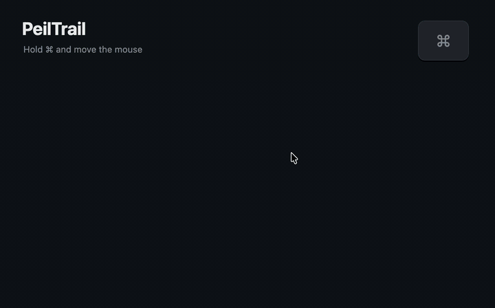
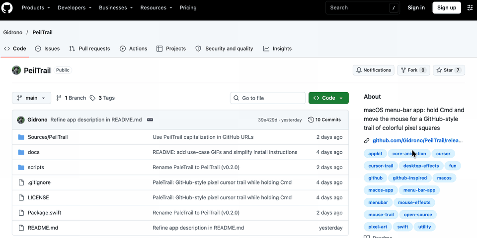
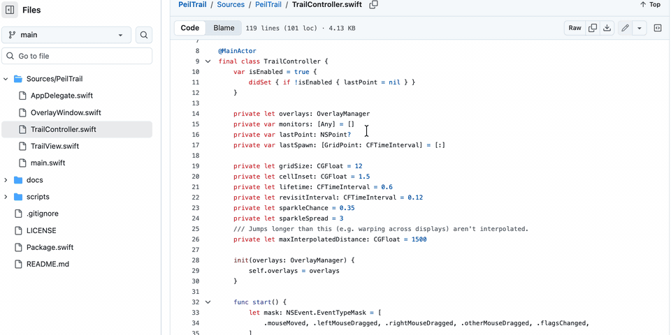
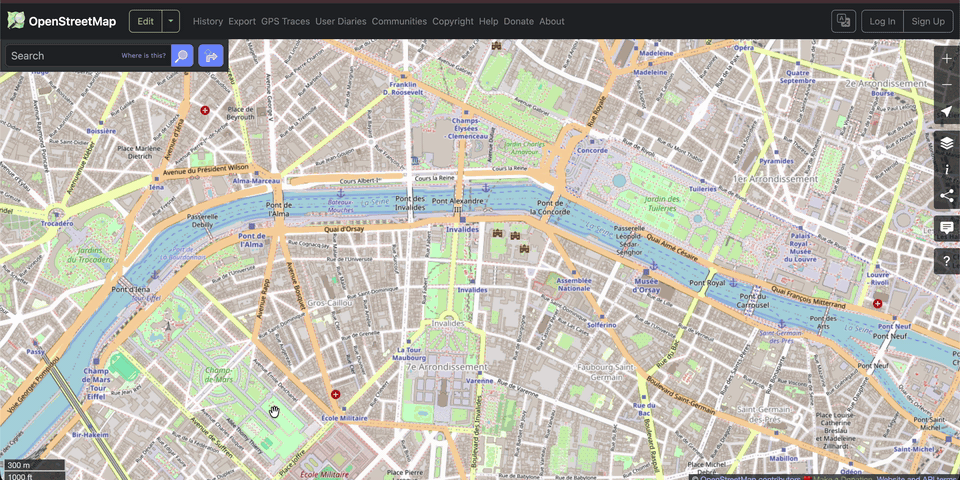
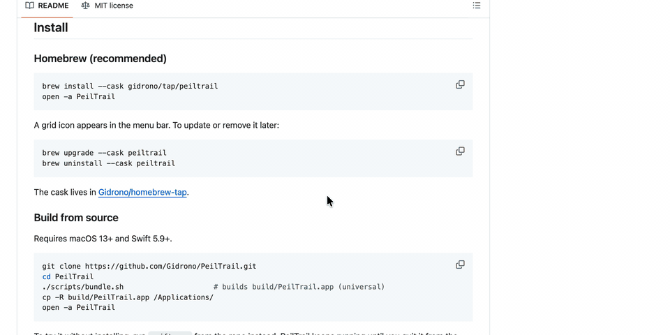

# PaleTrail

[](LICENSE)


[](https://github.com/Gidrono/paletrail/releases/latest)

A tiny macOS menu-bar app that paints a GitHub-style trail of colorful pixel squares behind your cursor while you hold **⌘ Command**.



Inspired by the pixel cursor trail on [github.com](https://github.com/).

## Features

- Hold ⌘ and move the mouse to leave a trail of grid-snapped squares (GitHub's green, blue, purple and pink by default). Let go and the trail fades away.
- Pick from 8 colour palettes in the menu bar: GitHub (default), Earthy, Sunset, Fire, Ocean, Forest, Neon and Pastel.
- Squares fade and shrink after ~600 ms, with small "sparkle" squares scattered around the path.
- Works on every display and Space, including over full-screen apps.
- Click-through overlay: it never steals clicks or focus.
- Zero CPU when idle: Core Animation drives the fades, so there's no frame loop.
- Universal app for Apple Silicon and Intel Macs.
- Menu-bar toggles for **Enabled** and **Launch at Login**.

## Use cases

Hold ⌘ to point things out on screen: in a Zoom or Meet screen share, a code review, a tutorial recording, or just for fun.

<table>
  <tr>
    <td width="50%"></td>
    <td width="50%"></td>
  </tr>
  <tr>
    <td><b>Screen sharing:</b> circle buttons and underline text while you talk. <i>Neon palette.</i></td>
    <td><b>Code review:</b> bracket a block, circle a value, underline a call. <i>Ocean palette.</i></td>
  </tr>
  <tr>
    <td></td>
    <td></td>
  </tr>
  <tr>
    <td><b>Maps and walkthroughs:</b> trace a route from A to B. <i>Fire palette.</i></td>
    <td><b>Docs and flair:</b> highlight the command to run, then draw a heart. <i>Earthy palette.</i></td>
  </tr>
</table>

## Install

### Homebrew (recommended)

```bash
brew install --cask gidrono/tap/paletrail
open -a PaleTrail
```

A grid icon appears in the menu bar. To update or remove it later:

```bash
brew upgrade --cask paletrail
brew uninstall --cask paletrail
```

The cask lives in [Gidrono/homebrew-tap](https://github.com/Gidrono/homebrew-tap).

### Build from source

Requires macOS 13+ and Swift 5.9+. Full Xcode isn't needed: the Command Line Tools 15+ are enough (`xcode-select --install`).

```bash
git clone https://github.com/Gidrono/paletrail.git
cd paletrail
./scripts/bundle.sh                     # builds build/PaleTrail.app (universal)
cp -R build/PaleTrail.app /Applications/
open -a PaleTrail
```

To try it without installing, run `swift run` from the repo instead. PaleTrail keeps running until you quit it from the menu bar or press Ctrl-C in Terminal.

### Download the app

Download **[PaleTrail.zip](https://github.com/Gidrono/paletrail/releases/latest/download/PaleTrail.zip)** from the [latest release](https://github.com/Gidrono/paletrail/releases/latest), unzip it, drag **PaleTrail.app** into **Applications**, and open it. The app is signed and notarized by Apple, so it opens without Gatekeeper warnings.

## Usage

- **Hold ⌘ and move the mouse** to draw the trail. Let go of ⌘ before you click, since many apps treat ⌘-click as a different action.
- Click the grid icon in the menu bar to:
  - toggle **Enabled** on or off,
  - turn on **Launch at Login** (only works when running from `/Applications`),
  - choose a **Palette** (each option shows its colours as a row of squares),
  - **Quit**.
- **Screen sharing:** the trail shows up in Zoom, Meet and screen recordings. Share your whole screen rather than a single window, because the trail is drawn in its own overlay window.

## Permissions

PaleTrail only watches mouse movement and whether ⌘ is held. It never reads what you type, so it usually needs no special permissions. If the trail doesn't show up, open **System Settings > Privacy & Security > Accessibility** (and **Input Monitoring**, if PaleTrail is listed there), allow PaleTrail, and relaunch it.

## Uninstall

If you installed with Homebrew, run `brew uninstall --cask paletrail` (add `--zap` to also remove its preferences).

Otherwise, quit PaleTrail from the menu bar, turn off Launch at Login if you enabled it, and delete `/Applications/PaleTrail.app`.

## Customize

All the knobs are plain constants:

| What | Where |
| --- | --- |
| Grid size, trail lifetime, sparkle amount | top of `Sources/PaleTrail/TrailController.swift` |
| Colors and palettes | `Palette.all` in `Sources/PaleTrail/TrailView.swift` |

## How it works

| File | Role |
| --- | --- |
| `TrailController.swift` | Global `NSEvent` monitors. While ⌘ is held, it interpolates grid cells between successive cursor positions so fast moves don't leave gaps. |
| `OverlayWindow.swift` | One borderless, transparent, click-through window per screen, at screen-saver level, on all Spaces. |
| `TrailView.swift` | Spawns a `CALayer` per cell with a fade and shrink animation, and removes it when the animation completes. |
| `AppDelegate.swift` | Menu-bar item, settings, and Launch at Login via `SMAppService`. |

## Releasing (maintainers)

With a Developer ID Application certificate in the keychain and a notarytool profile saved via `xcrun notarytool store-credentials paletrail`:

```bash
VERSION=X.Y.Z ./scripts/bundle.sh --notarize   # signs, notarizes, staples, zips
gh release create vX.Y.Z build/PaleTrail.zip
```

Then bump `version` and `sha256` in the [Homebrew cask](https://github.com/Gidrono/homebrew-tap/blob/main/Casks/paletrail.rb).

## Contributing

Issues and pull requests are welcome! Ideas: more trail styles, a settings window, a configurable modifier key.

## License

[MIT](LICENSE) © Gidi (Gidrono)
